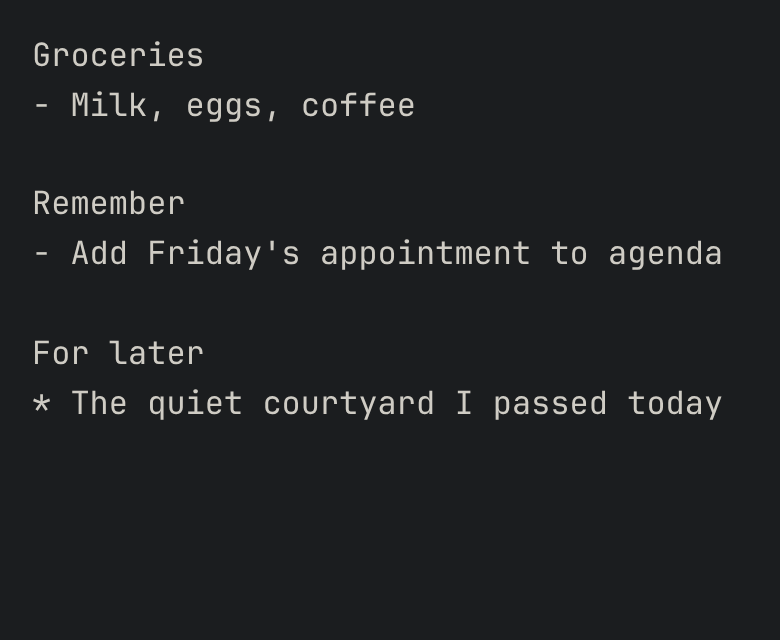

# Jotter

One place to jot things down.

Jotter is a minimal, focused scratchpad that opens straight into writing. Capture a thought, a link, or a quick note, then find the same text on your other devices.



Self-hosted, with offline writing, sync when connected, and Android sharing for text and links.

> [!WARNING]
>
> Jotter currently has no built-in login. Deploy behind a trusted private HTTPS access boundary. Anyone who can reach the service can access the scratchpad. Production requires `AUTH_DISABLED=true` to acknowledge that boundary.

## Run locally

```sh
git clone https://github.com/Muatasim-Aswad/jotter.git
cd jotter
MISE_LOCKED_SCOPES=project mise install --locked
pnpm install --frozen-lockfile
mise run dev
```

Requires [mise](https://mise.jdx.dev/), Python 3.11+, and the pinned toolchains. Open `http://127.0.0.1:5173`. Both development listeners use loopback. Build information is available at `/about`.

## Deploy

Use the published image: download one Compose file, set your private HTTPS origin, and start. Or build from source through the same Compose file. Docker manages persistent storage; no host build tools or data-directory setup are required. The [limitations](docs/limitations.md) describe browser verification, offline recovery, and backup requirements.

For managing Jotter alongside other self-hosted apps, you can use [srvr](https://github.com/Muatasim-Aswad/srvr).

## Development

See [development](docs/development.md) for setup and `mise run verify`, the shared local/CI gate. [Contributions](CONTRIBUTING.md) use focused pull requests from forks.

## Documentation

- [Architecture and decisions](docs/architecture.md) · [Domain glossary](CONTEXT.md)
- [Development](docs/development.md) · [Contributing](CONTRIBUTING.md)
- [Protocol and OpenAPI](docs/protocol.md) · [Configuration](docs/configuration.md)
- [Deployment](docs/deployment.md) · [Backup, restore, and releases](docs/release.md)
- [Limitations and data handling](docs/limitations.md) · [Security](SECURITY.md) · [Changelog](CHANGELOG.md)

Licensed under [MIT](LICENSE). Bundled validator attribution is in [third-party notices](THIRD_PARTY_NOTICES.md).
