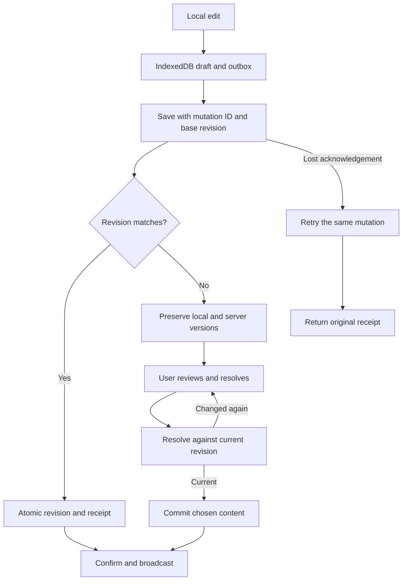

# Architecture

Jotter V1 is a single-origin PWA backed by one Go process and one SQLite database. The browser renders immediately from durable local state, then reconciles with the server. The server is authoritative for committed revisions; dirty browser content is never silently replaced.

## Repository boundaries

- `packages/protocol` owns the authoritative OpenAPI contract, generated TypeScript wire types and static validators, content codecs, and shared fixtures. Generated Go equivalents and the embedded schema live in `apps/server/internal/protocol`; both languages execute the same fixtures.
- `apps/web` is a vanilla TypeScript/Vite PWA. `app/bootstrap.ts` composes browser storage, transports, sessions, and views. `features/editor` owns the editor controller, sync model, conflict resolution, orphan recovery, and views behind its public `index.ts`. External storage and transport adapters remain in `storage` and `transport`; `sw.ts` owns static caching and share ingestion.
- `apps/server/internal/scratchpad` owns content rules, models, typed results, and the persistence interface consumed by the service. It does not import HTTP, WebSocket, JSON, or SQLite.
- `apps/server/internal/storage/sqlite` owns migrations and atomic persistence. `transport/http` and `transport/ws` decode requests, call the service, and translate typed results. `cmd/jotter` composes dependencies and owns process lifecycle.
- `apps/server/internal/webassets/dist` is generated from `apps/web/dist` and embedded in the Go binary. Production serves the browser, API, health endpoints, and WebSocket from one origin.

## How synchronization works

SQLite owns committed revisions. IndexedDB owns unsent work. A stale save preserves both versions for review; an identical retry returns its original receipt. Changed requests cannot reuse a mutation identity.

## Browser state

IndexedDB stores the clean server cache, installation identity, per-session drafts and outboxes, unresolved conflicts, share inbox, and device-local editor position. A tab identity lives in session storage. Distinct offline tabs keep distinct drafts; orphaned drafts are replayed deterministically and remain until an accepted receipt or preserved conflict proves their outcome.

Conflict resolution and orphan replay are separate workflows with injected stores and clients. Their tests exercise failed requests, changed server revisions, legacy receipts, and newer pending edits without DOM or browser storage mocks. The controller coordinates these workflows and the view; bootstrap constructs external dependencies.

Input is reflected immediately, persisted without blocking the visible edit, and queued as at most one in-flight mutation plus one coalesced pending mutation. Normal saves begin about 300 ms after typing stops and flush on focus or visibility loss. Reconnect uses durable mutation identities, so a lost acknowledgement can return its original receipt.

The service worker precaches only the application shell and fingerprinted assets. It never caches API, health, conflict, or WebSocket traffic. A URL-encoded `POST /share` is committed to the IndexedDB inbox before a `303 /` redirect; the foreground app appends each inbox record exactly once through the normal draft/save path. Background Sync is not a correctness dependency.

The compact About Jotter view shows running and deployed build identity, checks `/version.json` uncached, exposes failed checks, and offers Reload when identities differ. Reload first persists local edits and refuses a failed save. A new worker activates on install, so the next launch runs the new build; that first launch shows a one-time "Updated to …" toast (`jotter:seen-revision` in local storage). Production `/version.json` carries `Cache-Control: no-store` and bypasses the worker.

## Server state and transactions

SQLite contains `scratchpads`, `conflicts`, and content-free `mutation_receipts`. WAL mode, foreign keys, a five-second busy timeout, full synchronous durability, and one database connection support the single-process contract. An advisory file lock gives the process exclusive database ownership before embedded forward migrations run. Readiness probes SQLite; shutdown closes the database before releasing ownership.

An accepted save looks up its mutation receipt before comparing revisions, updates content and revision, and records the receipt in one transaction. A stale save creates or returns one conflict containing submitted and server versions in one transaction. Conflict resolution compares the newest revision, commits the chosen content, and deletes the conflict atomically. Acknowledgements and broadcasts occur only after commit; the in-memory hub contains connections, never canonical content.

WebSocket sessions subscribe before reading the initial snapshot. Committed updates queue during bootstrap; initial state is sent before those updates, and the client's revision guard discards updates already covered by the snapshot.

## Production boundary

Production requires an explicit HTTPS public origin and `AUTH_DISABLED=true`. HTTP requests carrying an unexpected `Origin` and WebSocket upgrades without the exact configured origin are rejected. The configured public host and loopback hosts are accepted; other hosts are rejected. The reverse proxy must preserve the configured host. HTTP bodies and WebSocket messages are bounded, document content is capped at 1 MiB of normalized UTF-8, and browser responses receive a restrictive same-origin CSP and standard isolation headers. The inline-style CSP exception exists only because the conflict screen constructs its local style element at runtime; network schemes remain disallowed.

Logs are JSON lifecycle and outcome events without document, share, or conflict bodies. SIGINT or SIGTERM marks readiness false, closes WebSockets with a restart reason, gives HTTP work ten seconds to drain, closes SQLite, and exits. The container runs as numeric UID/GID `10001:10001` with a read-only root filesystem in the supplied Compose profile; only `/data` and a small temporary filesystem are writable.

## Deliberate trade-offs

Full snapshots make retry receipts, revision checks, and conflict preservation easy to inspect for a single document capped at 1 MiB. They cost more bandwidth than operations and require user review for divergent edits. [Decision 1](adr/0001-revision-conflicts.md) records that choice.

This is a single-process local application, so migrations run at startup after acquiring exclusive database ownership rather than in a separate Compose migration service. SQLite lives on local disk; replicas and network storage are unsupported. [Decision 2](adr/0002-sqlite-ownership.md) records the deployment boundary.

Existing IDs use UUIDv4 and remain opaque across storage and the wire. UUIDv7 is a reasonable choice for new indexed record streams; changing current identifiers offers little benefit for one scratchpad and would complicate durable browser identities.

Vanilla TypeScript is sufficient for one editor and one conflict screen. A framework would add lifecycle and dependency overhead without a routing or component ecosystem need. Feature grouping and explicit dependency composition keep that choice reversible.

OpenAPI is the cross-language contract source, so static JSON Schema validators replace a second handwritten Zod schema. Validators are generated ahead of time to satisfy CSP without runtime code generation. Generated wire types remain separate from domain models; `mise run contracts:generate` refreshes them and verification rejects drift.

Authentication belongs to the trusted private access boundary in V1. Origin and host checks constrain browser requests; they do not authenticate callers. [Decision 3](adr/0003-private-access-boundary.md) records the scope and its consequences.

The boundary permits 32 concurrent ordinary requests and 16 WebSocket connections. Non-health HTTP traffic shares a 64 requests/second budget with a burst of 128; each WebSocket permits 20 messages/second with a burst of 40. Excess HTTP work receives `429` and `Retry-After`; excess WebSocket traffic closes the connection. Drafts remain durable during retry. Health endpoints bypass the traffic budget so saturation cannot hide liveness.

Receipts retain request fingerprints, IDs, revisions, and timestamps for at most seven days or 1,000 receipts per scratchpad. They contain no document bodies and are not history. Unresolved conflicts retain both bodies until resolution. Browser replicas and manual backups may retain older content; operators control their deletion and backup retention. [Limitations](limitations.md) describes recovery scope.

## Verification and recovery

`mise run verify` is the shared local/CI gate; the optional pre-commit hook runs the smaller `check:fast` gate. Browser test sources are included in formatting, linting, and strict type checking. Generated build directories are ignored; `mise run build` produces the embedded assets and binary from source.

Disposable SQLite integration tests restore accepted content, unresolved conflicts, and retry receipts from a copied database family. The container verifier checks an offline staging copy with `jotter verify-data`, starts it separately, and confirms the original persisted probe survived. Operators must [verify a staging restore before replacing live data](release.md).
